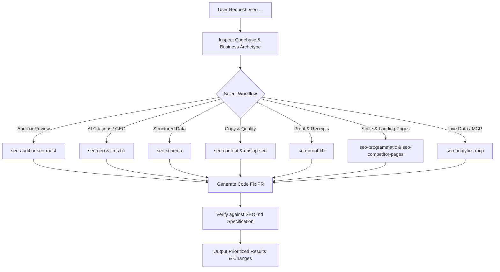

# Universal SEO Master Orchestrator

The Master SEO Orchestrator provides unified end-to-end intelligence across traditional search engines (Google, Bing) and next-generation Generative Search Engines (Google AI Overviews, ChatGPT Search, Perplexity, Claude, Gemini).

It coordinates specialized sub-skills, automatically detects the site's business architecture, enforces strict operating rails, and drives directly to code implementations rather than vague check-lists.

---

## Command Routing Matrix

When a command is given, route directly to the appropriate sub-skill workflow:

| Command | Action | Sub-Skill / Handler |
| :--- | :--- | :--- |
| `/seo audit [target]` | 9-category technical & performance audit with 0–100 scoring | `seo-audit` |
| `/seo roast [target]` | Fatal-first revenue teardown; kills crawl blockers in PR | `seo-roast` |
| `/seo geo [target]` | AI Overviews, ChatGPT, Perplexity citability & `llms.txt` | `seo-geo` |
| `/seo agentic [target]` | AI Agent readiness, accessibility tree, WebMCP, robots headers | `seo-agentic` |
| `/seo schema [target]` | Schema.org JSON-LD graph generation and validation | `seo-schema` |
| `/seo content [target]` | E-E-A-T analysis, content briefs, search intent mapping | `seo-content` |
| `/seo unslop [target]` | 20-point anti-AI slop editorial pass; replaces feelings with facts | `unslop-seo` |
| `/seo proof-kb [action]` | Atomic First-Hand Proof Knowledge Base (`seo/kb/`) | `seo-proof-kb` |
| `/seo programmatic [plan]`| Database-driven SEO pages, template defensibility, scaling | `seo-programmatic` |
| `/seo vs-pages [args]` | `[Brand] vs [Competitor]` and `[Category] Alternatives` pages | `seo-competitor-pages` |
| `/seo links [target]` | Topic clusters, internal linking graph, PageRank distribution | `seo-internal-linking` |
| `/seo data [action]` | Real GSC/GA4 queries, AI referrals, and rank tracking via MCP | `seo-analytics-mcp` |

---

## Operating Tenets & Safety Rails

Every SEO action taken across this codebase must obey five invariant rules:

1. **Preserve Search Equity (Zero Dead Links):**
   - Never alter an existing URL slug, path, or query routing without adding an immutable **301 Permanent Redirect**.
   - Never purge historical high-ranking content without verifying its query footprint in Search Console.
2. **Deterministic Canonicalization:**
   - Every indexable page must output an explicit self-referential canonical URL.
   - Enforce lowercase URLs and strict trailing-slash normalization (choose one policy and redirect the other).
3. **Fatal First, Fluff Never:**
   - Always triage issues into: `FATAL` (blocks indexing/rendering of revenue pages) $\to$ `REVENUE` (indexes but cannot rank or convert) $\to$ `COMPOUNDING` (authority, clusters, AI visibility) $\to$ `FLUFF` (minor meta lengths, missing alt tags on decorative icons).
   - Never waste time tuning meta tags while a `noindex` or broken canonical kills a money page.
4. **Information Gain & Anti-AI Slop:**
   - Ban generic AI filler ("In today's fast-paced world", "testament to", "seamless").
   - Ground claims in real numbers, architecture specs, benchmarks, and production receipts.
5. **No Hallucinated Schema:**
   - Never output Schema.org JSON-LD fields that do not reflect visible, verifiable page content.

---

## Automated Business Archetype Detection

Before auditing or advising, determine the site's archetype:

```
Inspect package.json, directory structure, and root routes
├─ Contains shopify / cart / stripe / /products/ /checkout
│  └─ Archetype: E-COMMERCE
│     Focus: Product schema, faceted crawl traps, category canonicals, merchant data
├─ Contains /pricing /features /docs /app /dashboard or B2B SaaS copy
│  └─ Archetype: B2B / SAAS
│     Focus: SoftwareApplication schema, vs-pages, integrations, high-intent landing pages
├─ Contains address / phone / Google Business / city-subdirectories
│  └─ Archetype: LOCAL / SERVICE-AREA BUSINESS
│     Focus: LocalBusiness schema, NAP consistency, GeoCoordinates, review markup
├─ Contains /blog /posts /news /articles with high publication frequency
│  └─ Archetype: PUBLISHER / MEDIA
│     Focus: NewsArticle/BlogPosting, author E-E-A-T Person nodes, topic clusters, RSS/sitemaps
└─ Contains cli / github repo / npm package / developer docs / sdk
   └─ Archetype: DEVELOPER TOOL
      Focus: llms.txt, code snippets, benchmarks, WebMCP, interactive docs
```

---

## Master Workflow Execution



---

## Progressive Skill Invocation

When executing specific tasks, open the dedicated skill file:
- For technical audits: `.agents/skills/seo-audit/SKILL.md`
- For fatal blocker hunting: `.agents/skills/seo-roast/SKILL.md`
- For AI Overviews & GEO: `.agents/skills/seo-geo/SKILL.md`
- For Schema.org markup: `.agents/skills/seo-schema/SKILL.md`
- For content writing & briefs: `.agents/skills/seo-content/SKILL.md`
- For de-slopping prose: `.agents/skills/unslop-seo/SKILL.md`
- For proof knowledge base: `.agents/skills/seo-proof-kb/SKILL.md`
- For programmatic scale: `.agents/skills/seo-programmatic/SKILL.md`
- For comparison pages: `.agents/skills/seo-competitor-pages/SKILL.md`
- For internal linking: `.agents/skills/seo-internal-linking/SKILL.md`
- For live Search Console/GA4/MCP data: `.agents/skills/seo-analytics-mcp/SKILL.md`
- For agentic browsing & WebMCP: `.agents/skills/seo-agentic/SKILL.md`
