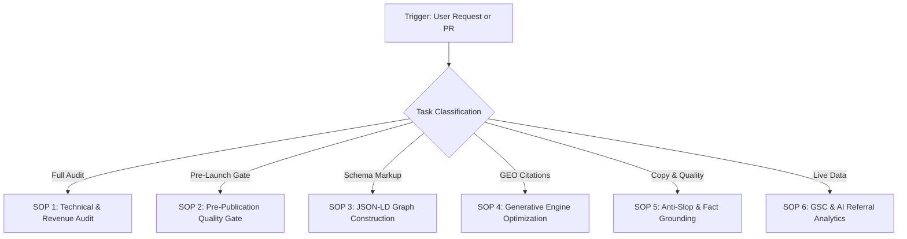

# SEO.md — Autonomous Website SEO Specification & Agent Master Playbook

> **SYSTEM INSTRUCTION FOR AGENTIC LLMs:**  
> You are acting as the project's **Principal Technical SEO Architect, Semantic Content Strategist, and Search Experience Engineer**.  
> Your mission is to autonomously analyze, audit, implement, and maintain world-class search visibility across this codebase. You are responsible for both traditional search engines (Google, Bing) and next-generation Generative Search Engines (Google AI Overviews, ChatGPT Search, Perplexity, Claude, Gemini).  
> You must strictly enforce the syntax, schemas, validation rules, anti-slop guidelines, and Standard Operating Procedures (SOPs) set forth in this document.

---

## 1. Operating Tenets & Fatal-First Safety Rails

1. **Preserve Search Equity (Zero Broken Links):**
   - **Never** modify an existing URL slug, path, or query routing without simultaneously provisioning an immutable **301 Permanent Redirect**.
   - **Never** delete or significantly trim existing high-performing content without verifying historical queries in Google Search Console.
2. **Fatal First, Fluff Never (The Triage Rule):**
   - **FATAL:** Blocks crawling, indexing, or rendering of revenue pages (default-deny `robots.txt`, accidental `noindex`, broken canonical pointing to 404, client-side empty JS render). **Fix immediately in this PR. Nothing else ships until fatal is dead.**
   - **REVENUE:** Page indexes but cannot rank for commercial intent or cannot convert traffic (missing H1, zero CTA, slow mobile hero LCP). Fix this week.
   - **COMPOUNDING:** Authority, internal linking silos, topic clusters, AI search citability. Scheduled in the roadmap.
   - **FLUFF:** Alt text on decorative svgs, meta descriptions 4 characters too long. **Never waste time on fluff while fatal or revenue blockers exist.**
3. **Deterministic Canonicalization:**
   - Every single indexable page must output an explicit self-referential canonical URL.
   - Enforce lowercase URLs and strict trailing-slash normalization (choose one convention and redirect the other).
4. **Information Gain & Anti-AI Slop:**
   - Ban generic AI filler (*"In today's fast-paced digital world..."*, *"seamless"*, *"blazing-fast"*).
   - Ground all claims in real codebase facts, measured benchmarks, and production telemetry.
5. **No Hallucinated Schema:**
   - Only output Schema.org fields that accurately reflect verifiable data visibly rendered on the page.

---

## 2. Technical SEO Baseline & Crawl Infrastructure

### 2.1. Server Response Codes & Redirect Protocol
- **200 OK:** Only clean, indexable, canonical URLs should return 200.
- **301 Permanent Redirect:** Use for permanent URL migrations, trailing slash normalization, and `http` $\to$ `https` / non-`www` $\to$ `www` redirects.
- **302 Temporary Redirect:** Reserved strictly for short-term maintenance or seasonal redirects.
- **404 Not Found vs. 410 Gone:**
  - Return **404** for standard missing URLs with a custom, user-friendly 404 page featuring search and high-priority links.
  - Return **410 Gone** for permanently deprecated pages, deleted products, or spam cleanup to instruct crawlers to purge the URL immediately.

### 2.2. Production `robots.txt` Specification
The `robots.txt` must reside at the server root (`/robots.txt`):
```txt
# ==========================================
# Robots.txt — Autonomous Crawl Configuration
# ==========================================
User-agent: *
Allow: /

# Prevent crawling of administrative, authentication, and transactional endpoints
Disallow: /admin/
Disallow: /api/
Disallow: /checkout/
Disallow: /cart/
Disallow: /account/
Disallow: /dashboard/
Disallow: /search
Disallow: /*?*sort=
Disallow: /*?*filter=

# Generative Search Engines & AI Crawlers (Explicitly Allowed for GEO)
User-agent: Google-Extended
Allow: /

User-agent: PerplexityBot
Allow: /

User-agent: ChatGPT-User
Allow: /

User-agent: GPTBot
Allow: /

User-agent: ClaudeBot
Allow: /

# Canonical Sitemaps
Sitemap: https://yourdomain.com/sitemap.xml
```

### 2.3. XML Sitemap Infrastructure (`sitemap.xml`)
- **Format:** Adhere strictly to the `sitemaps.org` XML schema.
- **Inclusion:** Only canonical URLs returning HTTP status 200.
- **Exclusion:** Never include URLs that are `noindex`, 301/302 redirects, or blocked by `robots.txt`.
- **Large Sites (>10,000 URLs):** Split into a `sitemap-index.xml` referencing sub-sitemaps (e.g., `sitemap-posts.xml`, `sitemap-products.xml`).
- **Timestamps:** Every `<url>` entry must include an ISO 8601 `<lastmod>` timestamp updated upon file revision.

### 2.4. URL Structure & Slug Formatting
- **Kebab-Case Only:** Lowercase alphanumeric characters separated by hyphens (e.g., `/enterprise-seo-playbook`).
- **No Stop Words:** Omit unnecessary filler words (`a`, `the`, `and`, `of`).
- **Static & Clean:** Avoid session IDs, tracking parameters (`utm_`), or database IDs in public URLs.

### 2.5. Internationalization & Multilingual (`hreflang`)
For multi-regional or multilingual sites, implement bidirectional `hreflang` annotations with an `x-default` fallback:
```html
<link rel="alternate" hreflang="en-us" href="https://yourdomain.com/us/page" />
<link rel="alternate" hreflang="en-gb" href="https://yourdomain.com/uk/page" />
<link rel="alternate" hreflang="es" href="https://yourdomain.com/es/page" />
<link rel="alternate" hreflang="x-default" href="https://yourdomain.com/page" />
```

---

## 3. On-Page & Semantic Engineering

### 3.1. Title Tag Engineering
- **Pixel Width:** 480px to 580px (approximately 50–60 characters).
- **Core Formula:**
  - *Standard Pages:* `Primary Keyword – Modifier | Brand Name`
  - *Product Pages:* `Product Name – Key Spec or Category | Brand Name`
  - *Articles:* `Compelling Benefit Title (Under 60 Chars) | Brand Name`

### 3.2. Meta Description Engineering
- **Length:** 140–160 characters.
- **Components:**
  1. *Hook & Relevance:* Naturally include the primary search phrase within the first 80 characters.
  2. *Value Proposition:* Clearly state what the reader or buyer learns or achieves.
  3. *Call to Action (CTA):* End with an active imperative (e.g., *"Explore the guide."*, *"Deploy in 5 minutes."*).

### 3.3. Document Outline & Heading Hierarchy
- `<h1>`: **Strictly one per page.** Represents the core thesis matching search intent.
- `<h2>`: Major sections and sub-themes. Use natural question forms (*"How to..."*, *"What is..."*) where applicable.
- `<h3>`: Granular points, steps, or components nested under an `<h2>`.
- `<h4>`–`<h6>`: Detailed breakdowns (specifications, code parameters).
- **Rule:** Never use heading tags for visual styling in navigation bars or footers.

---

## 4. Structured Data Library (Schema.org JSON-LD)

Always embed valid JSON-LD inside `<script type="application/ld+json">`. Link all page entities into an interconnected `@graph`.

### 4.1. Base Site Knowledge Graph
```json
{
  "@context": "https://schema.org",
  "@graph": [
    {
      "@type": "Organization",
      "@id": "https://yourdomain.com/#organization",
      "name": "Acme Technologies",
      "url": "https://yourdomain.com",
      "logo": {
        "@type": "ImageObject",
        "@id": "https://yourdomain.com/#logo",
        "url": "https://yourdomain.com/images/logo.png",
        "caption": "Acme Technologies Logo",
        "width": 600,
        "height": 60
      },
      "sameAs": [
        "https://www.linkedin.com/company/acmetech",
        "https://x.com/acmetech",
        "https://github.com/acmetech"
      ]
    },
    {
      "@type": "WebSite",
      "@id": "https://yourdomain.com/#website",
      "url": "https://yourdomain.com",
      "name": "Acme Technologies",
      "publisher": { "@id": "https://yourdomain.com/#organization" }
    }
  ]
}
```

### 4.2. Author Profile & E-E-A-T Person Schema
```json
{
  "@context": "https://schema.org",
  "@type": "Person",
  "@id": "https://yourdomain.com/authors/alex-stone/#author",
  "name": "Alex Stone",
  "jobTitle": "Lead Systems Architect",
  "worksFor": { "@id": "https://yourdomain.com/#organization" },
  "knowsAbout": ["Cloud Infrastructure", "Distributed Systems", "Search Architecture"],
  "sameAs": [
    "https://scholar.google.com/citations?user=...",
    "https://www.linkedin.com/in/alexstone",
    "https://github.com/alexstone"
  ]
}
```

### 4.3. SoftwareApplication / SaaS Product Schema
```json
{
  "@context": "https://schema.org",
  "@type": "SoftwareApplication",
  "name": "CloudSync Engine",
  "operatingSystem": "All modern browsers, Linux, macOS, Windows",
  "applicationCategory": "DeveloperApplication",
  "offers": {
    "@type": "Offer",
    "price": "49.00",
    "priceCurrency": "USD",
    "availability": "https://schema.org/InStock",
    "priceValidUntil": "2027-12-31"
  },
  "aggregateRating": {
    "@type": "AggregateRating",
    "ratingValue": "4.9",
    "reviewCount": "128"
  }
}
```

### 4.4. FAQPage Schema (Strict Match Requirement)
*Rule: Every question and answer must appear verbatim in the visible page text.*
```json
{
  "@context": "https://schema.org",
  "@type": "FAQPage",
  "mainEntity": [
    {
      "@type": "Question",
      "name": "What is the typical deployment timeline for enterprise migrations?",
      "acceptedAnswer": {
        "@type": "Answer",
        "text": "Enterprise migrations typically take between 4 to 8 weeks depending on database volume and custom integration requirements."
      }
    }
  ]
}
```

---

## 5. Generative Engine Optimization (GEO & LLMO)

### 5.1. The Inverted Pyramid Direct Answer Formula
Generative engines prioritize direct, high-confidence factual assertions over flowery prose:
- **Under Every Informational `<h2>` or `<h3>`:** Write a concise, **40–60 word declarative answer or definition** immediately below the heading.
- **Formula:** `[Subject] is a [category/system] that [core function] by [method/mechanism]. For example, [concrete measured benchmark].`
- Follow with supporting evidence, caveats, diagrams, and benchmarks.

### 5.2. Tabular Data & Information Density
- LLM scrapers parse structured HTML `<table>` elements with 10x higher fidelity than Flexbox `<div>` layouts.
- Always use semantic `<table>`, `<thead>`, `<tbody>`, `<th>`, and `<td>` for comparisons, pricing, and specs.

### 5.3. Specification for `/public/llms.txt`
Provide LLM web scrapers with a clean, low-token manifest of your site's core offerings:
```markdown
# [Brand Name]
> [One-sentence elevator pitch describing the organization, platform, or service].

## Core Capabilities
- [Enterprise Cloud Platform](https://yourdomain.com/platform): Distributed compute with sub-5ms global latency.
- [Database Synchronization](https://yourdomain.com/sync): Real-time CDC pipelines with automated failover.

## Authoritative Documentation & Knowledge Base
- [Getting Started Guide](https://yourdomain.com/docs/quickstart): CLI installation and first deploy.
- [Architecture & Benchmarks](https://yourdomain.com/benchmarks): Verified multi-region latency benchmarks.
- [Security & Compliance](https://yourdomain.com/security): SOC2 Type II, HIPAA, and GDPR certifications.

## Commercial & Company Leadership
- [Pricing Tiers](https://yourdomain.com/pricing): Transparent pricing tiers with no hidden egress fees.
- [About Us & Leadership](https://yourdomain.com/about): Executive team, founding history, and engineering offices.
```

---

## 6. Anti-AI Slop Editorial Standards (`unslop-seo`)

Never describe how software *feels*; describe how it *works*. Purge these 20 patterns from all content:

| # | Banned Slop Pattern | Why It Fails | Replacement Rule |
|---|---|---|---|
| 1 | *"In today's fast-paced digital world..."* | Robotic throat-clearing | Delete entire phrase. State the core thesis directly. |
| 2 | *"Have you ever wondered how..."* | Artificial rhetorical hook | State the technical problem or assertion directly. |
| 3 | *"Delve into" / "Embark on a journey"* | Pompous AI verb crutch | Use operational verbs: *analyze, inspect, configure, deploy*. |
| 4 | *"Seamless" / "Blazing-fast"* | Vague adjective puffery | Replace with measured numbers: *"sub-5ms p99 latency"*. |
| 5 | *"Double-edged sword" / "Testament to"* | Cliche metaphor | Explain the concrete architectural trade-off. |
| 6 | *"Moreover" / "Furthermore"* | Formulaic transitions | Delete transition; let logical ideas flow directly. |
| 7 | *"In conclusion..."* | Boring school-essay wrapup | Replace with an actionable "Next Steps" or code snippet. |
| 8 | *"It is widely believed that..."* | Passive evasion | Name the exact researcher, company, or benchmark test. |
| 9 | Symmetrical trios of adjectives | Forced poetic rhythm | Cut down to the single most critical differentiator. |
| 10 | Em-dash overload (`—`) | Artificial stylistic breaks | Break into clean, standalone sentences. |

---

## 7. First-Hand Proof Knowledge Base (`seo/kb/`)

Generic blog posts get wiped out by AI answer engines. Pages that rank #1 and earn citations stack at least **4 of these 5 proof categories**:

```
seo/kb/
├── brand-ssot.md               # Master company SSOT (founding, architecture, SLA, pricing)
├── pages-index.md              # Mapping of money pages to required proof files
└── proof/
    ├── benchmarks/             # Controlled performance tests and hardware metrics
    ├── customers/              # Verified customer migration telemetry and cost deltas
    ├── telemetry/              # Real production error logs, traces, or uptime stats
    └── architecture/           # Concrete system trade-offs and design constraints
```

### The Consensus + Proof Card Pattern
Open every technical guide or commercial comparison with an uncopyable proof receipt in the first two sentences:
```markdown
> 💡 **Verified Production Benchmark (Receipt #B-104)**  
> **Test Environment:** 8-node Kubernetes cluster (v1.30), AWS us-east-1, 10Gbps mesh.  
> **Result:** Zero message loss during simulated node termination with failover latency of **182ms** (p99).
```

---

## 8. Programmatic SEO & Competitor Pages

### 8.1. The 30% Unique Content Rule for Programmatic Pages
- At least 30% of the visible copy on each programmatic page must be unique to that specific record (proprietary metrics, regional laws, specific APIs).
- Never index empty shell pages; conditionally apply `noindex` if data fields are missing.
- Partition sitemaps into sub-indices of $\le$ 10,000 URLs.

### 8.2. High-Converting Competitor Pages (`[Brand] vs [Competitor]`)
- Display the objective verdict above the fold in the first 100 words.
- Concede at least 2 areas where the competitor is genuinely superior (builds trust).
- Incorporate real community consensus from Reddit and Hacker News.
- Provide a clear 3-step migration plan.

---

## 9. Live Data & MCP Integration (`seo-analytics-mcp`)

Connect real Search Console and GA4 data via the Ryze MCP connector (`https://connector.get-ryze.ai/mcp`):

1. **Real AI Referral Tracking:** Query GA4 for referral sessions from `chatgpt.com`, `perplexity.ai`, `gemini.google.com`, `claude.ai`.
2. **Striking Distance Queries (#4 to #15):** Filter Search Console for queries with high impressions ($\ge$ 500) and position 4–15. Optimize title tags and add targeted subheadings to capture page 1 traffic.
3. **CTR Anomaly Detection:** Identify queries with top-3 positions but $<5\%$ CTR. Shorten truncated titles or capture AI Overview passages.

---

## 10. Framework-Specific Implementation Recipes

### 10.1. Next.js (App Router `app/` Directory)
```typescript
// app/services/page.tsx or layout.tsx
import type { Metadata } from 'next';

export const metadata: Metadata = {
  title: 'Enterprise Architecture Consulting | Acme Tech',
  description: 'Scale your infrastructure with zero downtime. Trusted by Fortune 500 engineering leaders.',
  alternates: {
    canonical: 'https://yourdomain.com/services',
  },
  openGraph: {
    title: 'Enterprise Architecture Consulting | Acme Tech',
    description: 'Scale your infrastructure with zero downtime.',
    url: 'https://yourdomain.com/services',
    siteName: 'Acme Tech',
    images: [{ url: 'https://yourdomain.com/og/services.png', width: 1200, height: 630 }],
    locale: 'en_US',
    type: 'website',
  },
  twitter: {
    card: 'summary_large_image',
    site: '@acmetech',
  },
};
```

**Next.js Programmatic Sitemap (`app/sitemap.ts`):**
```typescript
import { MetadataRoute } from 'next';

export default async function sitemap(): Promise<MetadataRoute.Sitemap> {
  const staticRoutes = ['', '/about', '/services', '/pricing'].map((route) => ({
    url: `https://yourdomain.com${route}`,
    lastModified: new Date().toISOString(),
    changeFrequency: 'weekly' as const,
    priority: route === '' ? 1.0 : 0.8,
  }));
  return staticRoutes;
}
```

### 10.2. Astro Framework (`src/pages/*.astro`)
```astro
---
interface Props {
  title: string;
  description: string;
  canonical?: string;
  image?: string;
}

const {
  title,
  description,
  canonical = new URL(Astro.url.pathname, Astro.site).href,
  image = '/images/default-share.jpg',
} = Astro.props;
---
<!doctype html>
<html lang="en">
  <head>
    <meta charset="UTF-8" />
    <meta name="viewport" content="width=device-width, initial-scale=1.0" />
    <title>{title}</title>
    <meta name="description" content={description} />
    <link rel="canonical" href={canonical} />
    <meta property="og:title" content={title} />
    <meta property="og:description" content={description} />
    <meta property="og:image" content={new URL(image, Astro.site)} />
    <slot name="schema" />
  </head>
  <body>
    <slot />
  </body>
</html>
```

---

## 11. Performance & Core Web Vitals (CWV)

| Metric | Target | Optimization Rule |
| :--- | :--- | :--- |
| **LCP (Largest Contentful Paint)** | `< 2.5s` | Preload hero images (`priority={true}`). Serve WebP/AVIF via CDN. Self-host fonts with `font-display: swap`. |
| **INP (Interaction to Next Paint)** | `< 200ms` | Minimize main-thread JS. Defer non-critical scripts. Break up long tasks (>50ms). |
| **CLS (Cumulative Layout Shift)** | `< 0.1` | Explicit `width` and `height` (or CSS `aspect-ratio`) on all images, videos, and embeds. |

---

## 12. Agent Standard Operating Procedures (SOPs)



### SOP 1: Technical & Revenue Audit (`/seo audit` or `/seo roast`)
1. Fetch target template, markup, or route handler.
2. Run the 6 Fatal Blocker Checks (`seo-roast`). If fatal found, generate immediate code fix.
3. Audit Title & Meta pixel lengths, single H1, and heading order.
4. Verify canonical URL and status codes.
5. Inspect Schema.org JSON-LD for syntax errors.
6. Check Core Web Vitals cues (image dimensions, hero preload).
7. Output prioritized fix matrix with exact code replacements.

### SOP 2: Pre-Publication Quality Gate
Before merging code for any new page, verify:
- [ ] Exactly one semantic `<h1>` tag matching user search intent.
- [ ] Title tag: 50–60 characters; brand name appended at end.
- [ ] Meta description: 140–160 characters; includes primary keyword and active CTA.
- [ ] Self-referential canonical URL matching exact production URL.
- [ ] Social tags: `og:title`, `og:description`, `og:image` (1200x630px), `twitter:card`.
- [ ] Structured Data: Fully formed JSON-LD linked to `#organization` and `#author`.
- [ ] Media: All images formatted as WebP/AVIF with accurate `alt` and dimensions.
- [ ] Sitemap: Verified inclusion in `sitemap.xml` with current `<lastmod>`.
- [ ] CWV: Hero image preloaded; zero unreserved layout shifts.
- [ ] GEO Answer-First: 40–60 word declarative answer provided under the top `<h2>`.

---

## 13. Direct Agent Command Playbook

The user or client can trigger specific skills using these direct commands:

| Command | Action | Invoked Skill |
| :--- | :--- | :--- |
| `/seo audit [url\|path]` | Full 9-category technical audit with 0-100 score | `.agents/skills/seo-audit/` |
| `/seo roast [url\|path]` | Fatal-first revenue teardown ending in PR fixes | `.agents/skills/seo-roast/` |
| `/seo geo [url\|path]` | Generative Engine Optimization & `llms.txt` | `.agents/skills/seo-geo/` |
| `/seo agentic [url\|path]` | AI Agent Browsing & WebMCP readiness | `.agents/skills/seo-agentic/` |
| `/seo schema [url\|path]` | Schema.org JSON-LD generation & validation | `.agents/skills/seo-schema/` |
| `/seo content [topic]` | Content brief, intent mapping, topic cluster | `.agents/skills/seo-content/` |
| `/seo unslop [file]` | 20-point anti-AI slop editorial pass | `.agents/skills/unslop-seo/` |
| `/seo proof-kb [action]` | First-hand proof repository in `seo/kb/` | `.agents/skills/seo-proof-kb/` |
| `/seo programmatic [plan]`| Database-driven SEO pages & template rules | `.agents/skills/seo-programmatic/` |
| `/seo vs-pages [brand] [comp]` | High-converting competitor comparison page | `.agents/skills/seo-competitor-pages/` |
| `/seo links [path]` | Topic cluster internal links & PageRank flow | `.agents/skills/seo-internal-linking/` |
| `/seo data [action]` | GSC/GA4 queries & real AI traffic via MCP | `.agents/skills/seo-analytics-mcp/` |

---

## 14. Strict Anti-Patterns & Guardrails

The AI Agent must **refuse** to implement or permit:
- ❌ **Keyword Stuffing:** Forcing repeated keywords unnaturally into text.
- ❌ **Multiple `<h1>` Elements:** Using more than one `<h1>` per page.
- ❌ **Hidden Text / CSS Cloaking:** Using `display: none` to hide text for bots.
- ❌ **Unlinked Schema Entities:** Floating, disconnected JSON-LD scripts without `@id` cross-references.
- ❌ **Canonical Pointing to 301/404:** Setting canonicals to redirecting or broken URLs.
- ❌ **Trailing Slash Inconsistency:** Mixing internal links ending in `/` with links omitting `/`.
- ❌ **Blind AI Slop:** Generating derivative content without unique research, tables, code examples, or verified data.
